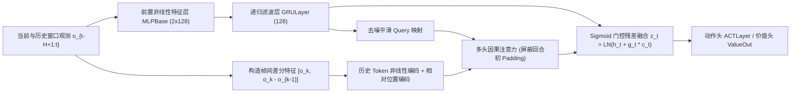

# 「时序注意力 + SPO」观测退化根因分析与毕设改进实施方案

本文档汇总了对现有实验结果（[attention_16_8_4_2_gru_spo/summary.csv](file:///e:/clone/demo2/experiments/results/observation_degradation/attention_16_8_4_2_gru_spo/summary.csv) 与 [ppo_spo_attention_noisy/summary.csv](file:///e:/clone/demo2/experiments/results/observation_degradation/ppo_spo_attention_noisy/summary.csv)）的根因诊断，以及经讨论对齐后的代码改造、实验设计与论文图表落地方案。

---

## 一、前期实验未见效的根因总结

### 1. 时序注意力（`TemporalAttention`）未跑赢 `GRU` 的三大原因
1. **单帧特征提取能力不对等**：在 [ppo_actor.py](file:///e:/clone/demo2/algorithms/ppo/ppo_actor.py#L28-L35) 中，`GRU` 前置了 2 层非线性 [mlp.py](file:///e:/clone/demo2/algorithms/utils/mlp.py#L30-L51)（`12 -> 128 -> 128`，含 `ReLU + LayerNorm`），而 [temporal_attention.py](file:///e:/clone/demo2/algorithms/utils/temporal_attention.py#L40-L66) 仅用单层线性映射 `nn.Linear(obs_dim, d)` 投射异构物理量（三角函数姿态、线速度、目标误差），导致在无退化 `E0` 上就已经比 `PPO+GRU` 低约 `10` 分，与无记忆 `PPO+MLP` 接近。
2. **单步脏 Query 与有限窗口瓶颈**：[temporal_attention.py](file:///e:/clone/demo2/algorithms/utils/temporal_attention.py#L68-L70) 仅用最后一帧观测作唯一 Query，并直接叠加残差 `tokens[:, -1] + attended`。在近似全可观测的 [heading_task.py](file:///e:/clone/demo2/envs/JSBSim/tasks/heading_task.py#L72-L110) 中，训练梯度沿残差捷径退化为单帧网络；测试遇到 `E4~E6` 强噪声和丢帧冻结时，末帧 Query 自身失真，且缺少 `GRU` 式的无限递归低通滤波记忆。
3. **训测退化分布失配且缺少冻结感知**：训练环境 [singlecontrol_env.py](file:///e:/clone/demo2/envs/JSBSim/envs/singlecontrol_env.py#L88-L96) 仅注入独立高斯白噪声（无丢帧、无时延），而测试脚本 [heading_observation_degradation_eval.py](file:///e:/clone/demo2/experiments/heading_observation_degradation_eval.py#L79-L105) 注入了「噪声 + 零阶保持丢帧 + 队列时延」且仅作用于前 3 维误差通道。注意力位置编码只区分时间先后，无法识别某几帧是否因丢帧而被零阶保持冻结。

### 2. 策略优化（`SPO`）未跑赢 `PPO-Clip` 的两大原因
1. **多维离散动作空间的联合概率比畸变**：底层飞控动作空间为 `MultiDiscrete([41, 41, 41, 30])`（`D = 4`），[act.py](file:///e:/clone/demo2/algorithms/utils/act.py#L138) 对 4 个通道的 `log_prob` 求和，使联合概率比变为 `r = r₁ × r₂ × r₃ × r₄`。`PPO-Clip` 越界后仅截断为零梯度；而 [ppo_trainer.py](file:///e:/clone/demo2/algorithms/ppo/ppo_trainer.py#L63-L64) 中 `SPO` 的二次惩罚在越过 `1 ± ε` 后施加反向拉回梯度，直接复用单维 `ε = 0.2` 会把每个通道允许的单步更新幅度压缩至约 `ε / 4 = 0.05`。
2. **样本复用轮次过低（`ppo_epoch=4`）未进入 SPO 优势区**：在 `96,000` 步大批量 + `ppo_epoch=4` 设置下，[training-summary.json](file:///e:/clone/demo2/scripts/results/SingleControl/1/heading/ppo/heading_clip_mlp_noisy/run1/training-summary.json) 显示 `PPO-Clip` 的 `approx_kl` 仅 `0.0077`，完全无策略崩溃风险；换用 `SPO` 后 [training-summary.json](file:///e:/clone/demo2/scripts/results/SingleControl/1/heading/ppo/heading_spo_mlp_noisy/run1/training-summary.json) 的 `approx_kl` 被压至 `0.00197`（越界率仅 `0.89%`），更新过度保守导致速度通道欠拟合。`SPO` 真正发挥优势的区间是**较高样本复用率（`ppo_epoch=8~10`）与带噪非平稳自博弈**。

---

## 二、核心改进方案设计

> [!IMPORTANT]
> 总体路线采用**「第三章底层飞控 + 第四章高层 1v1 战术自博弈」双闭环验证**：底层先快速验证新模块在连续指令跟踪与退化下的正向增益；高层固定原 `envs/JSBSim/model/actor_heading.pt` 控制单变量，在 `1v1/NoWeapon/TacticalHierarchySelfplay`（`Discrete(12)`）上展开完整自博弈与机载火控雷达退化评估。

### 1. 时序模块改造：门控递归-因果注意力编码器（`gru_attention`）

在保留 `MLPBase -> GRU` 递归低通滤波能力的基础上，引入带**帧间差分感知**的历史窗口因果注意力分支，并通过可学习门控残差融合：

- **帧间差分与丢帧冻结感知**：在编码器内部对历史窗口计算相邻有效帧差分 `Δoₖ = oₖ − oₖ₋₁`，拼接为 `[o_k, Δo_k]`（不改变外部环境的 `observation_space`）。当发生零阶保持丢帧时，退化通道的 `Δoₖ = 0`，注意力 Key/Value 可直接识别冻结帧并回溯丢帧前的有效机动帧；正常更新时，`Δoₖ` 显式提供目标角速度与距离变化率信息。
- **去噪平滑 Query**：不再用可能被单步强噪声污染的原始末帧做 Query，而是由 `GRU` 滤波后的平滑隐状态 `hₜ` 线性映射生成 Query，提高高噪条件下的注意力权重稳定性。
- **门控残差保底**：融合门控 `gₜ = σ(W_g [hₜ, cₜ] + b_g)` 的偏置 `b_g` 初始化为 `-2.0`（初始门控开度约 `0.12`），确保训练初期和干净 `E0` 工况下性能下限严格对齐 `PPO+GRU` baseline，仅在需要跨步回溯与延迟补偿时自适应打开门控。
- **统一序列训练生成器**：将 `GRU` 隐状态 `[1, 128]` 与历史原始窗口 `[H, d_obs + 1]` 打包进同一 `state_shape`，在 `T=1`（采样/评估）与 `T=L`（`ReplayBuffer.recurrent_generator` 序列块训练）中同步滑动与按 `masks` 重置，使 `GRU` 与 `gru_attention` 使用完全相同的序列切片与反向传播长度。

### 2. 策略优化改造：维度自适应几何概率比 SPO（Dimension-Adaptive SPO）

针对动作空间自由度数 `D`（`Discrete` 为 `D = 1`，`MultiDiscrete` 为 `D = len(nvec)`，`Tuple` 按子空间累加），定义**几何平均概率比**：

$$r_{\text{geo}}(\theta) = \exp\left(\frac{1}{D}\left(\log \pi_\theta(a \mid s) - \log \pi_{\theta_{\text{old}}}(a \mid s)\right)\right)$$

将 SPO 替代目标统一写为：

$$\mathcal{L}_{\text{SPO-Geo}}(\theta) = -\mathbb{E}_t \left[ D \cdot \left( r_{\text{geo}}(\theta) \hat{A}_t - \frac{|\hat{A}_t|}{2\epsilon} \left(r_{\text{geo}}(\theta) - 1\right)^2 \right) \right]$$

- **理论性质（可直接写入论文第三章）**：
  1. **一阶梯度无偏性**：在 `θ = θ_old`（即 `r_geo = 1`）处，`∇_θ 𝓛_SPO-Geo = −𝔼ₜ[∇_θ log π_θ(a | s) Âₜ]`，与标准策略梯度完全一致。
  2. **维度无关信任域**：对任意动作自由度数 `D ≥ 1`，目标函数的极值点恒位于单自由度几何均值 `r_geo* = 1 + sign(Âₜ) ε`，彻底消除 4 维飞控动作空间中联合概率比指数膨胀导致的步长锁死。
  3. **单维严格退化**：当 `D = 1`（如第四章 `1v1` 的 `Discrete(12)` 战术动作空间）时，`r_geo(θ) ≡ r(θ)`，严格退化为 ICML 2025 原始 SPO 公式。
- **公平训练超参对齐**：所有对比算法统一设置 `--ppo-epoch 8`、`--num-mini-batch 8`、`--clip-param 0.2`（保持 `buffer_size=3000`、`n_rollout_threads=32`），在完全一致的梯度更新次数下检验高样本复用时的抗越界稳定性。

### 3. 退化环境一致性建模与 1v1 真值解耦

> [!WARNING]
> 在 [singlecombat_task.py](file:///e:/clone/demo2/envs/JSBSim/tasks/singlecombat_task.py#L343-L367)（以及评估脚本 [1v1.py](file:///e:/clone/demo2/experiments/1v1.py#L481-L505)）中，`TacticalHierarchicalSingleCombatTask._combat_geometry` 当前直接读取 `enm.get_position()` 和 `enm.get_velocity()` 真值解算追击向量。若不解耦，即使 `obs[9:15]` 完全失真，纯追击/提前量追击动作仍能精确指向敌机真值位置。

1. **第三章底层 `SingleControl/1/heading` 混合退化训练**：
   - 扩展 [singlecontrol_env.py](file:///e:/clone/demo2/envs/JSBSim/envs/singlecontrol_env.py)，新增混合退化环境（支持 `--heading-degradation-mode mixed`），每局按概率 `[0.25, 0.30, 0.25, 0.20]` 采样 `E0`（干净）与 `E1~E3`（高斯噪声 + `10%~30%` 零阶保持丢帧 + `1~3` 步时延），退化通道与 [heading_observation_degradation_eval.py](file:///e:/clone/demo2/experiments/heading_observation_degradation_eval.py#L79-L105) 严格对齐；保留 `E4~E6`（`40%~60%` 丢帧、`4~6` 步时延）作为训练未见的分布外（OOD）泛化测试。
2. **第四章高层 `1v1` 机载火控雷达退化模型（`RadarTrackDegrader`）**：
   - 在敌机东北天（NEU）三维位置与速度航迹层面对齐建模「角度/距离测量高斯噪声 + 随机脱锁丢帧（零阶保持）+ 滤波跟踪队列时延」。
   - 本机的相对态势观测 `obs[9:15]` 与 `_combat_geometry` 战术导引律**共享同一份退化后的敌机雷达航迹状态**；而 JSBSim 动力学积分、近距火炮判伤与奖励结算仍严格基于物理真值。
   - 自博弈训练期启用多档位雷达退化域随机化（按 `[0.30, 0.35, 0.35]` 混合 `E0`、`E1`、`E2`）；评估期测试 `E0`（干净）、`E1~E2`（分布内退化）、`E3~E4`（分布外强退化，最高至丢帧 `45%`、时延 `5` 步）。

---

## 三、涉及修改的代码清单

| 模块层级 | 目标文件 | 核心修改内容 |
| :--- | :--- | :--- |
| 时序编码器 | [temporal_attention.py](file:///e:/clone/demo2/algorithms/utils/temporal_attention.py) | 新增 `GatedAttentionGRU`（`--memory-encoder gru_attention`），支持 `[o_k, Δo_k]` 差分编码、平滑 Query、门控残差及 `T=1` / `T=L` 双模式展开 |
| 策略与网络 | [ppo_actor.py](file:///e:/clone/demo2/algorithms/ppo/ppo_actor.py)、[ppo_critic.py](file:///e:/clone/demo2/algorithms/ppo/ppo_critic.py)、[ppo_policy.py](file:///e:/clone/demo2/algorithms/ppo/ppo_policy.py) | 接入 `gru_attention` 分支，保存并校验 `model_config.json` 结构元数据 |
| SPO 训练器 | [ppo_trainer.py](file:///e:/clone/demo2/algorithms/ppo/ppo_trainer.py)、[config.py](file:///e:/clone/demo2/config.py) | 实现基于动作自由度数 `D` 的 `SPO-Geo` 几何概率比惩罚；`gru_attention` 走 `recurrent_generator`；记录门控均值与概率比监控指标 |
| 底层退化环境 | [singlecontrol_env.py](file:///e:/clone/demo2/envs/JSBSim/envs/singlecontrol_env.py)、[train_jsbsim.py](file:///e:/clone/demo2/scripts/train/train_jsbsim.py) | 新增 `HeadingMixedDegradationEnv` 支持含丢帧与时延的多档位混合退化训练及固定档位定期验证 |
| 高层雷达退化 | [singlecombat_task.py](file:///e:/clone/demo2/envs/JSBSim/tasks/singlecombat_task.py)、`envs/JSBSim/envs/singlecombat_env.py` | 实现 `RadarTrackDegrader`，在训练/评估退化模式下让 `get_obs` 与 `_combat_geometry` 共用退化雷达航迹 |
| 评估与绘图脚本 | [heading_observation_degradation_eval.py](file:///e:/clone/demo2/experiments/heading_observation_degradation_eval.py)、[1v1.py](file:///e:/clone/demo2/experiments/1v1.py)、[partial_observability_gru_eval.py](file:///e:/clone/demo2/experiments/partial_observability_gru_eval.py) | 打通 `gru_attention` 加载、多训练种子聚合统计（均值±标准差/95% CI）、雷达航迹同步退化及注意力/门控可视化导出 |
| 训练脚本与单测 | [train_heading.sh](file:///e:/clone/demo2/scripts/train_heading.sh)、[train_tactical_selfplay.sh](file:///e:/clone/demo2/scripts/train_tactical_selfplay.sh)、`tests/` | 统一 `2×2 × 3 seeds` 启动参数；补充 `gru_attention`、`SPO-Geo`、雷达航迹无真值泄露的单元测试 |

---

## 四、高标准论文实验矩阵与排期（`2×2 × 3 Seeds`）

### 阶段 1：代码实现、单元测试与快速冒烟验证（第 1–2 天）
1. 完成上述 6 个模块的改造与单元测试（确保 `T=1` 采样与 `T=L` 序列训练前向输出及 log-prob 严格一致，零更新时 `r_geo = 1`）。
2. 在 `SingleControl/1/heading` 上先跑 `2e7` 步单种子快速检测试验（`PPO+GRU` vs `SPO+GRU-Attention`），确认：
   - `SPO-Geo` 的 `approx_kl` 恢复至合理活跃区间（`0.005 ~ 0.015`），不再被压死在 `0.002`；
   - `E0` 性能不低于 `PPO+GRU`，且 `E3~E6` 与 `--fixed-sequence` 连续机动跟踪显著优于 `PPO+GRU`。

### 阶段 2：第三章底层飞控完整消融实验（`1e8` 步 × 3 种子）

| 实验组代号 | 记忆编码器 | 策略目标 | 训练环境 | 步数与随机种子 |
| :--- | :--- | :--- | :--- | :--- |
| `C3-Base` | `gru` | `clip` | 混合误差退化（`E0~E3`） | `1e8` × `seed {1, 2, 3}` |
| `C3-Attn` | `gru_attention`（`H=16`） | `clip` | 混合误差退化（`E0~E3`） | `1e8` × `seed {1, 2, 3}` |
| `C3-SPO` | `gru` | `spo`（`SPO-Geo`） | 混合误差退化（`E0~E3`） | `1e8` × `seed {1, 2, 3}` |
| `C3-Full` | `gru_attention`（`H=16`） | `spo`（`SPO-Geo`） | 混合误差退化（`E0~E3`） | `1e8` × `seed {1, 2, 3}` |

- **评估输出（第三章核心图表）**：
  1. **训练收敛与优化稳定性对比图**（3 种子均值 ± 标准差阴影）：单局回报、验证达标率、`approx_kl` 与 `ratio_out_of_bounds` 曲线。
  2. **`E0~E6` 单指令稳态/外推退化对比表与折线图**（含成功率、航向/高度/速度 MAE、控制平滑度 `smoothness_l2`）。
  3. **`--fixed-sequence` 四阶段连续机动切换跟踪误差曲线**（重点展示指令切换瞬态响应与调节时间 `settling_time_sec`）。

### 阶段 3：第四章高层 1v1 战术分层自博弈消融实验（`1e8` 步 × 3 种子）

> [!TIP]
> 第四章所有实验组统一冻结并加载原有的 `envs/JSBSim/model/actor_heading.pt` 作为底层执行器，严格保证高层对比无底层变量干扰；自博弈算法统一采用 `fsp`（或 `pfsp`），`--ppo-epoch 8`，`--history-length 16`。

| 实验组代号 | 高层记忆编码器 | 高层策略目标 | 训练环境（`1v1/NoWeapon/TacticalHierarchySelfplay`） | 步数与随机种子 |
| :--- | :--- | :--- | :--- | :--- |
| `C4-Base` | `gru` | `clip` | 混合机载雷达退化（`E0/E1/E2`） | `1e8` × `seed {1, 2, 3}` |
| `C4-Attn` | `gru_attention`（`H=16`） | `clip` | 混合机载雷达退化（`E0/E1/E2`） | `1e8` × `seed {1, 2, 3}` |
| `C4-SPO` | `gru` | `spo` | 混合机载雷达退化（`E0/E1/E2`） | `1e8` × `seed {1, 2, 3}` |
| `C4-Full` | `gru_attention`（`H=16`） | `spo` | 混合机载雷达退化（`E0/E1/E2`） | `1e8` × `seed {1, 2, 3}` |

- **评估输出（第四章核心图表）**：
  1. **自博弈 ELO 演化与策略更新稳定性曲线**（3 种子均值 ± 标准差）。
  2. **`4×4` 跨算法交叉对抗胜率热力图（Cross-Play Matrix）**：在 `E0`（干净雷达）与 `E2`（中度雷达退化）下，每对算法跨 3 个种子交叉对战（交换红蓝阵位 + 随机初始阵位，计算胜率、平局率、净胜分及 Bootstrap 95% 置信区间）。
  3. **`E0~E4` 机载雷达退化鲁棒性退化曲线**：固定强对手（如干净环境 `C4-Base`），被测方承受 `E0~E4` 雷达退化，统计胜率、优势窗口占空比（`AO/TA <= 30°, R <= 3km`）及战术动作跳变率。
  4. **可解释性机理案例分析图（Tacview 轨迹 + 注意力热力图）**：抽取典型近距狗斗中敌机急转叠加雷达连续丢帧片段，联合展示三维对抗轨迹、12 类战术动作选择序列、门控开度 `gₜ` 以及历史窗口注意力权重 `α_(t,k)` 对丢帧前有效航迹帧的精准聚焦。
